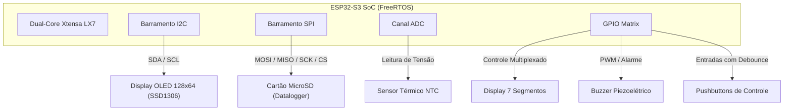

# ⚡ ESP32-S3 Embedded Firmware & Systems Engineering Lab

[-00599C.svg?logo=c)](https://en.wikipedia.org/wiki/C_(programming_language))
[](https://www.freertos.org/)
[](https://idf.espressif.com/)
[](https://www.espressif.com/)
[](https://wokwi.com/)

Repositório de projetos e implementações de firmware embarcado em **C** utilizando **FreeRTOS** e o framework **ESP-IDF** sobre o microcontrolador **ESP32-S3**.

O ecossistema abrange desde o design de diagramas esquemáticos e arquiteturais até o desenvolvimento de drivers para barramentos industriais (**I2C**, **SPI**), periféricos analógicos (**ADC**), sensores inerciais/térmicos e sistemas completos de aquisição e registro de dados (**Datalogger**).

---

## 🛠️ Stack Tecnológica & Periféricos

* **Hardware / Core**: Espressif ESP32-S3 (Xtensa Dual-Core 32-bit LX7).
* **Sistema Operacional em Tempo Real**: FreeRTOS (Tasks, Queues, Timers, Semaphores).
* **Protocolos e Barramentos**:
  * **I2C**: Comunicação com IMU 6-DOF (MPU-6050) e Display OLED (SSD1306).
  * **SPI**: Interface de alta velocidade com módulo de cartão MicroSD (FATFS).
  * **ADC / PWM**: Leitura de termistores NTC, controle de frequência e modulação em buzzers piezoelétricos.
  * **GPIO**: Interrupções externas, debouncing e multiplexação de displays de 7 segmentos.
* **Ambiente de Simulação**: Wokwi Hardware Simulation Platform.

---

## 🏗️ Mapa de Módulos e Simulações

Todos os projetos contam com simulações funcionais na nuvem através do Wokwi:

| # | Módulo | Periféricos & Barramentos | Habilidades Chave | Simulação Online |
| :-: | :--- | :--- | :--- | :---: |
| **01** | **System Architecture** | Hardware Block Diagram | Modelagem de arquitetura e fluxo de barramentos | *(Documentação)* |
| **02** | **Circuit Schematics** | Hardware Circuit Design | Dimensionamento de resistores, pull-ups e pinouts | *(Documentação)* |
| **03** | **GPIO & Task Sequencing** | 4x LEDs, Resistores | FreeRTOS Tasks, atrasos não-bloqueantes (`vTaskDelay`) | [Simular no Wokwi](https://wokwi.com/projects/443619547381383169) |
| **04** | **PWM & Acoustic Signaling**| Buzzer Piezo, LEDs | Geração de tons PWM, temporização e modulação | [Simular no Wokwi](https://wokwi.com/projects/443619547381383169) |
| **05** | **Interrupts & Debounce** | Pushbuttons, LEDs | Interrupções de hardware (ISR) e tratamento de ruído | [Simular no Wokwi](https://wokwi.com/projects/444241756489125889) |
| **06** | **Alarm & IO State Machine**| Pushbuttons, Buzzer, LEDs | Máquina de estados para sistemas de alerta e segurança | [Simular no Wokwi](https://wokwi.com/projects/444874413562219521) |
| **07** | **I2C Inertial Telemetry** | MPU-6050, Display OLED SSD1306 | Barramento I2C, leitura de aceleração e plotagem gráfica | [Simular no Wokwi](https://wokwi.com/projects/445509672450697217) |
| **08** | **ADC Thermal Telemetry** | Sensor NTC, Buzzer, OLED | Conversão Analógico-Digital (ADC) e curva de Steinhart-Hart | [Simular no Wokwi](https://wokwi.com/projects/446660358861102081) |
| **09** | **SPI MicroSD Datalogger** | Leitor MicroSD, NTC, OLED, Buzzer | Barramento SPI, persistência de dados em arquivos | [Simular no Wokwi](https://wokwi.com/projects/446776478980520961) |
| **10** | **Integrated IoT Multi-System**| MicroSD, OLED, 7-Seg, NTC, Buzzer| Integração completa multithreading de sensores e atuadores | [Simular no Wokwi](https://wokwi.com/projects/447230279909410817) |

---

## 🔌 Arquitetura do Sistema Integrado (Módulo 10)



---

## 💻 Como Executar Localmente via ESP-IDF

### Pré-requisitos
* **ESP-IDF v5.x** configurado e instalado no sistema.
* Placa **ESP32-S3 DevKitC-1** (ou simulador compatível).

### Compilação e Gravação

```bash
# 1. Clone o repositório
git clone https://github.com/caiodantass/esp32-freertos-firmware-lab.git
cd esp32-freertos-firmware-lab

# 2. Acesse o diretório do módulo desejado (ex: Sistema Integrado)
cd 10-integrated-iot-multisensor-system

# 3. Defina o target para ESP32-S3
idf.py set-target esp32s3

# 4. Compile o projeto
idf.py build

# 5. Grave no microcontrolador e abra o monitor serial
idf.py -p (PORTA_SERIAL) flash monitor
```

---

## 👨‍💻 Autor

**Caio Dantas**  
* Engenheiro de Software / Desenvolvedor de Firmware  
* GitHub: [@caiodantass](https://github.com/caiodantass)  
* LinkedIn: [linkedin.com/in/caiodantass](https://www.linkedin.com/in/caio-l%C3%ADvio/)
